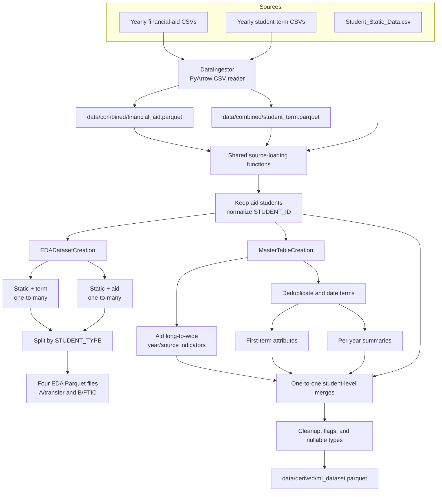

# Dataset Creation

<!-- dataset-creation-feature:start -->

## Purpose

The dataset-creation pipeline turns financial-aid, student-term, and student
static source tables into two kinds of analysis-ready outputs:

- **EDA datasets:** aid and term records joined separately to student static
  attributes, each split into transfer (`STUDENT_TYPE = A`) and FTIC
  (`STUDENT_TYPE = B`) populations.
- **ML dataset:** one row per aid student, with aid indicators and selected
  first-term and year-level summaries.

The pipeline prepares data for analysis; it does not split train/test data,
impute missing values, encode features, or scale data. Those operations belong
to later modeling or view-building steps.

## Data flow



Every Parquet output is written through `src/utils/save.py`. The save helper
reloads the file and checks its shape and dtypes against the in-memory
DataFrame; a failed write or check removes the incomplete output.

## Architecture and design rationale

### Shared source preparation

Shared functions centralize configuration loading, source loading, key
normalization, and student filtering. Both EDA and master-table creation
therefore start from the same normalized student population instead of
implementing slightly different versions of these rules.

Student identifiers and aid item codes are read as text so leading zeros and
nulls are not lost to numeric inference. `STUDENT_ID` values are stripped
before matching. The static table is required to contain one row per student,
and non-students are filtered from static and term data with a log message
recording the number removed.

### Keep long tables separate for EDA

Financial aid and student terms are both one-to-many tables by student. Joining
them directly would multiply a student's aid records by their term records and
inflate counts and totals. The EDA builder instead joins each table to static
attributes independently, validates the one-to-many relationship, checks that
the expected matches exist, and then creates the A/B splits(Transfer/FTIC).

### Build the ML table from student-level components

The ML output has one row per student, while raw aid and term data can have
many rows per student. The builder first reduces each source to a student-level
component—aid indicators, first-term attributes, and year summaries—then joins
those components to the one-row-per-student static table with one-to-one
validation. This keeps row counts predictable and makes duplicate-key or
unexpected merge behavior fail visibly.

Static cohort year is the source of truth for aid-year and term-year
calculations. Source cohort disagreements are retained as mismatch flags
rather than silently overwriting the source values. Missing first-term fields
stay missing instead of being filled from later terms. A missing year-level
term count becomes zero after the merge, while missing outcome measures remain
missing.

### Configuration and storage

EDA and ML each have a YAML config (`configs/eda.yaml` and `configs/ml.yaml`).
This keeps output paths, year ranges, selected columns, and cleanup rules
explicit and adjustable without duplicating the pipeline implementation.
`expected_rows` provides an optional check on the ML student population; set
it to `null` to skip that source-specific expectation.
The ML output is restricted to the ordered allow-list in `output_columns`, so
intermediate or unused fields do not leak into `ml_dataset.parquet`. Graduation
count column names are preserved from the source table.

Aid source groups are preserved independently. In particular, the ML config
includes `other` in `aid_sources`, so it creates its own `aid_yrN_src_other`
indicator instead of combining those records with private aid.

### Entry characteristics for transfer and FTIC students

Transfer and FTIC students arrive with different academic records, so the
modeling views in `configs/model_views.yaml` give each group its own feature
list instead of sharing one.

| Cohort | Entry features |
| --- | --- |
| FTIC (`STUDENT_TYPE = B`) | `Entry_Age`, `Entry_HS_GPA`, `ACT_TOTAL`, `Credits_Transfered_Max` |
| Transfer (`STUDENT_TYPE = A`) | `Entry_Age`, `Credits_Transfered_Max`, `AA_AS` |

**High school GPA was removed from the transfer views.** Transfer students
mostly don't have a high school GPA on record, so the column was almost
entirely missing for them. The preprocessor fills missing numbers with the
median and adds a "was missing" indicator, which meant the feature ended up
measuring whether the field was blank rather than anything about the student.
Leaving it in made the transfer models look like they accounted for prior
achievement when they didn't.

**The associate-degree flag (`AA_AS`) was added in its place.** Whether a
student transfers in with an AA or AS degree is available for this group and
says something real about how prepared they are. It goes in the numeric list
rather than `flags` for two reasons: `flags` is overwritten for every view by
the entry-load setting, and the numeric pipeline fills any missing values and
marks them, while `flags` passes values through untouched. Scaling a 0/1
column does no harm.

**FTIC views still use high school GPA.** Among first-time students, HS GPA
tends to fall in a narrow band, so it won't separate students very well. It's
still the main measure of prior achievement we have, and it matters most when
comparing students with different aid types. Institutional scholarships often
go to students with higher entry GPAs, so dropping it would make that
selection harder to account for. Keep its narrow range in mind as a
limitation when reading FTIC results.

A better transfer measure would be the GPA from the student's previous
institution. It isn't in the master table yet, but it's worth adding if the
source data has it.

Parquet is used for combined and derived datasets because it preserves column
types, nullable integer flags, text codes, and null values more reliably than
CSV. Pandas is used for the dataset transformations—filtering, joins,
reshaping, summaries, and type conversion—while PyArrow reads CSV ingestion
inputs in chunks.

## Main components

| Component | Responsibility |
| --- | --- |
| `src/preprocessing/data_ingestion.py` | Recursively discovers matching CSVs and reads them in parallel chunks, returning rows in file order; preserves `STUDENT_ID` and `ITEM_TYPE` as text. |
| `src/preprocessing/ingest_data.py` | Combines raw aid and term CSVs into Parquet outputs and checks row counts. |
| `src/preprocessing/dataset_creation.py` | Loads configured inputs, normalizes keys, and restricts static and term tables to aid students. |
| `src/preprocessing/eda_dataset_creation.py` | Creates separate aid/static and term/static joins and their A/B splits. |
| `src/preprocessing/master_table_creation.py` | Creates the one-row-per-student master table used by later analysis and modeling. |
| `src/utils/save.py` | Writes and round-trip verifies Parquet outputs. |

## Run the pipeline

Run these commands from the project directory:

```bash
python -m src.preprocessing.ingest_data
python -m src.preprocessing.eda_dataset_creation
python -m src.preprocessing.master_table_creation
```

The dataset-creation commands can also load existing combined Parquet files or
CSV files. When combined files are absent, they load matching raw aid and term
CSVs directly. The static table is loaded from
`data/raw_data/Student_Static_Data.csv`.

## Validation

The tests use small synthetic DataFrames and temporary CSV/Parquet files; they
do not require access to the project's student records. They cover key
preservation and student filtering, aid indicator columns, duplicate-term
selection, first-term null behavior, term-year mapping, year summaries,
master-table row invariants, cleanup types, EDA splits, and Parquet ingestion.

Run them with:

```bash
python -m unittest discover -s tests -v
```

<!-- dataset-creation-feature:end -->
